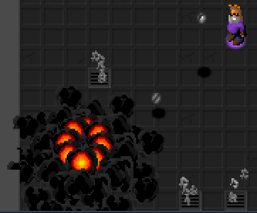
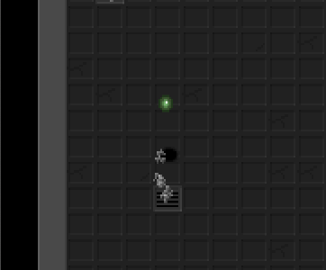
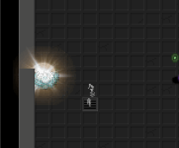
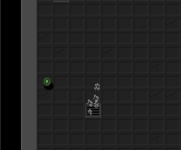
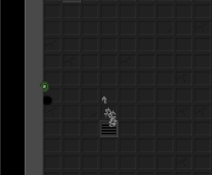
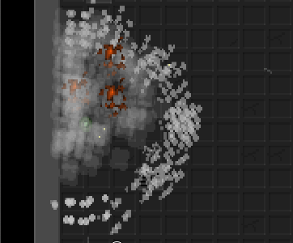
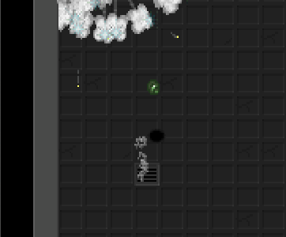
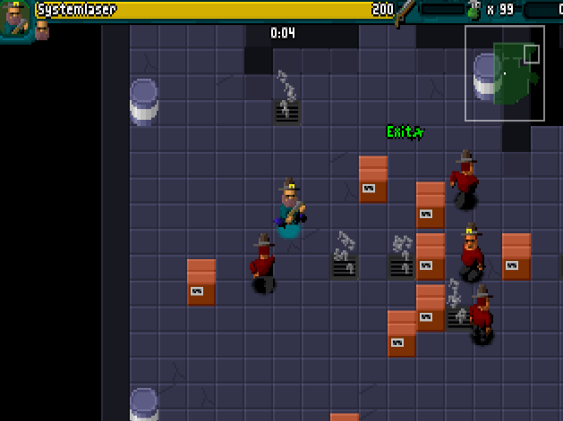

Explosions are perhaps the most iconic visual effect: loud, stunning, and complex. No video game - certainly no _violent_ video game - is complete without it. For most it's probably best to leave it to professionals, either get someone to make them for you or find a ready-made asset. But we're curious here so why not make our own? And by doing so, we can make it well adapted to our own game!

So first, the impetus of this exercise was [C-Dogs SDL](https://cxong.github.io/cdogs-sdl/). This game, a continuation of the classic 90's DOS game [C-Dogs](https://en.wikipedia.org/wiki/C-Dogs) also has the same explosions. For the time, it was pretty good:

While it still mostly holds up, it's been \*_checks watch_\* 3 decades. The original may have taxed the 486s of its time, but I reckon we can do better!

<!--more-->

In CG there are broadly two approaches, which I'll term _Simulationist_ and _Perceptionist_: the former tries to simulate the world according to how it works, and the latter focuses on making things look realistic or good and not worry about how it's done. Means vs ends, in other words. For our explosions, it means looking at how explosions _work_, vs how they _look_. I believe for games we need a healthy balance between the two. Simulationist as we are working with games after all, so making them dynamic means we can have them interact with the world: being shaped by the world geometry, and destroying in game entities in a sensible way. Perceptionist as games are entertainment and spectacle, so rule of cool and all that.

# How Explosions Work

> 
>
> <https://legionmagazine.com/inside-the-blast-part-1-anatomy-of-an-explosion/>

There are many kinds of explosions and they can look very different. In our exercise we are creating a [small-arms](https://en.wikipedia.org/wiki/Small_arms_and_light_weapons) explosion like from a grenade, and these look quite different in real life than typically depicted in entertainment. In real life they tend to have more "bite" than "bark", as their killing power mostly comes from shrapnel and the sheer explosive kinetic force, and show almost none of the big fireballs in movies that are actually achieved by [fuel explosions](https://www.youtube.com/watch?v=nqJiWbD08Yw).

Nevertheless we'll rule of cool this one and look at large explosions, which are the most impressive, have lots of different components, and also tend to have the giant fireballs that are usually too brief to be seen at small-arms scale. As seen in the above image, these can have:

- [Flash and thermal radiation](https://www.atomicarchive.com/science/effects/thermal-radiation.html), the first effect although it can last a few seconds, provides most of the destructive energy and can set things on fire
- Supersonic shockwave, radiating out ahead of the main explosion, and can sometimes be seen faintly but is most visible at ground level as it kicks up dirt and hapless bystanders
- Supersonic shrapnel, propelled outwards from deep within the explosion, basically coming from anything that was sturdy enough not to have been vaporised instantly
- Very bright fireball, usually yellow-white instead of movie-orange, and formed by mostly [superheated air and vaporised material](https://www.atomicarchive.com/science/effects/fireball.html) rather than burning fuel. Said fireball rises, grows and cools over time. Its size grows literally explosively at first, then reaches its maximum size in seconds
- Fading, darkening fireball, slowly over time. The lingering smoke can last quite a long time compared to everything before

# Movie Magic

Explosions in movies are different to real life for one main reason: they need to last longer. Unless the explosion is big, it usually dissipates too quickly and you're left with the boring smoke cloud, and big explosions are very expensive. This is why movies use a lot of [fuel explosions](https://www.timeout.com/film/the-hair-raising-stories-behind-the-biggest-explosions-in-movies) which burn longer, but look distinctly orange, and don't feature the other effects - shockwave, shrapnel and so on. But movie pyrotechnicians have way more tricks up their sleeves: from adding exploding glass, cork and paper to add shrapnel, debris and burning trails, to playing with fuel mixes (diesel gives of distinctive black smoke).

> 
>
> <https://vefects.itch.io/realistic-explosions-unreal-engine>

In VFX and video games, artists have more control so these secondary effects can be easily added and tweaked, but the general principle is the same: it's gotta last, and have lots of different components for interest.

# Putting it all together

Let's play with the following elements, in rough order of appearance:

1. Flash
2. Ground shockwave
3. High velocity shrapnel
4. Fireball
5. Smoke
6. Slow debris

First the flash. It looks like it lingers for too long but don't worry, it'll be covered by the other layers. In game it also deals the most damage - be unlucky enough to be at the centre of the explosion and you'll be instantly vaporised!

Now this gets interesting. For the shockwave, the air shockwave is a bit hard to achieve with pixel art sprites so I went with the ground shockwave, which is roughly a ring of dust/smoke particles, that expands fast but quickly slows down and dissipates. Here we also see one main advantage of simulating our explosion components in the game: they bounce off the walls realistically. Also in gameplay terms, the shockwave has strong pushback force but low damage - if you're caught near the explosion but react fast, you'll probably survive with a big jolt.

Here's the first bit of visual chaos: a burst of random, small, bright, fast-moving tracer particles. These travel even faster and further than the shockwave, yet have absolutely no gameplay effect. They do however hint at the destructive power of the explosion. Players who think they got hit by a bit of shrapnel but emerge unscathed will feel very lucky!

And this is the meat of the explosion: the fireball. These should look like they appear abruptly but subtly radiate out from the centre, starting bright and then quickly fading. Gameplay-wise, these deal high damage over time - if you're foolish enough to stay in the fireball, you'll be quickly burned. Now if it seems like the fireballs disappear too quickly you'd be right, which brings us to...

Smoke, which arrives shortly before the fireballs dissipate but linger much longer. The timing is key to getting it to look right.

Lastly we have slow-moving, high-flying debris that leave dramatic smoke trails, which add visual interest and prevents the explosion looking like just a blob. You could say that these represent large particles that the explosion couldn't fully vaporise, but let's be honest: we added these just to look cool.

And there you have it! A six-part dynamic explosion. How does it compare with the original C-Dogs explosion? I hope you found this exercise useful. Now go forth and make some cool explosions of your own!

